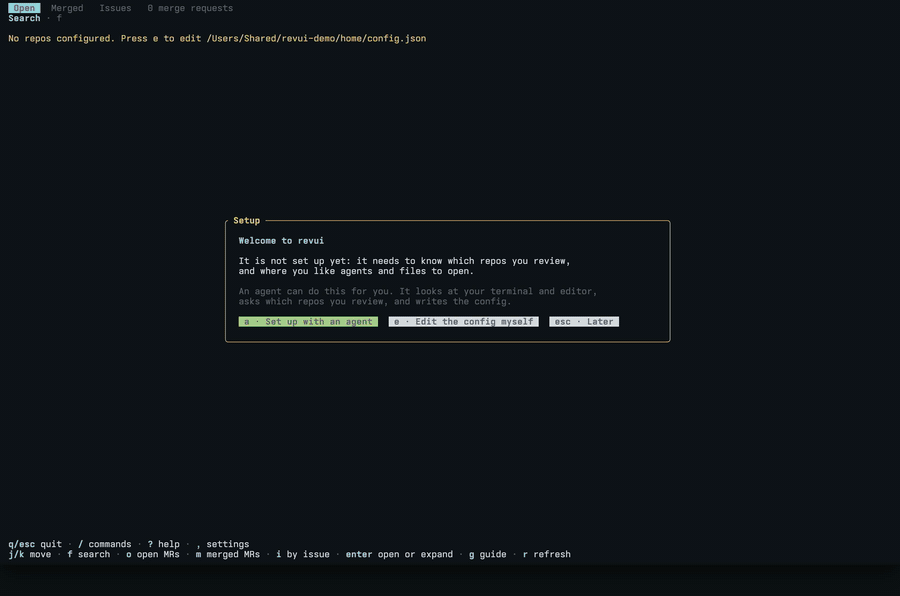
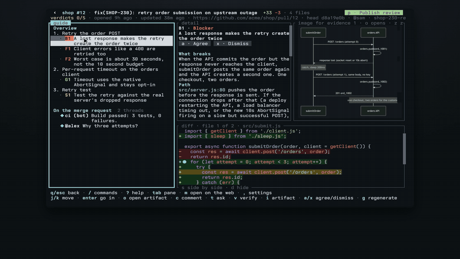
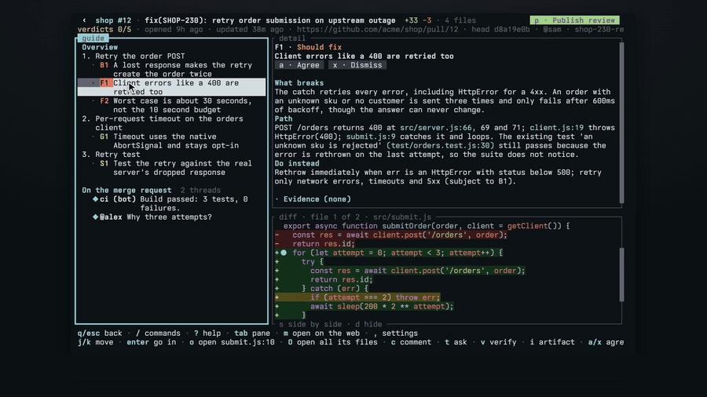
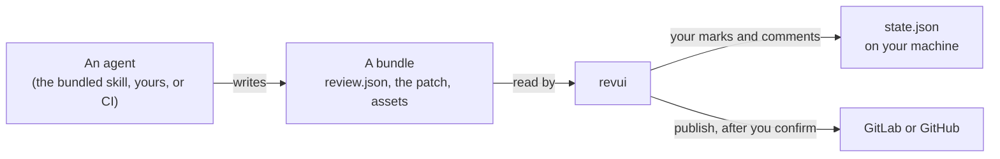

<p align="center">
  <picture>
    <source media="(prefers-color-scheme: dark)" srcset="docs/logo-dark.svg">
    
  </picture>
</p>

<p align="center">
  Paste a merge request link. An agent reviews it and hands you one finding at a time.<br>
  You check what matters, and publish your own review.
</p>

<p align="center">
  
</p>

## Quick start

```sh
cargo install --git https://github.com/Volpestyle/revui
revui
```

You need Rust, the CLI of your code host, signed in (`glab` for GitLab or `gh` for
GitHub), and a coding agent: Claude Code works with no setup. Then paste the link
of a merge request or pull request, or start with one: `revui <link>`.

The agent starts in a tab and reviews the change. The summary lands first, and
you read it while the findings arrive one by one.

> The screenshots and recordings below show the earlier layout, with a list of
> merge requests and a list of findings beside the code. They are due a re-record.

## What you get

<table>
  <tr>
    <td width="50%"></td>
    <td width="50%"></td>
  </tr>
  <tr>
    <td><b>Your reviews.</b> Every link you pasted, the latest first, with where you left off. No repos to configure, nothing loaded until you ask.</td>
    <td><b>One card at a time, not a wall of diff.</b> The summary, then each part of the change, the core first, with the findings for its code.</td>
  </tr>
  <tr>
    <td></td>
    <td></td>
  </tr>
  <tr>
    <td><b>Findings with evidence you can judge.</b> Each one says how it was checked: observed in a run, verified by a tool, or reasoned from reading. Screenshots and diagrams sit beside the code.</td>
    <td><b>Your review, in your words.</b> You see the exact text before anything is posted, and nothing goes out until you confirm.</td>
  </tr>
</table>

Two things it will not do:

- **Hide code.** A hunk the guide left out is flagged as "no section", and a
  guide that cites code outside the diff does not load.
- **Post for you.** Only what you agreed with, pushed back on or wrote yourself
  goes out, and only when you publish.

## With an agent

Each review has one agent, in a tab. It writes the review, and it is the one you ask afterwards, so it already knows the change. These are real
runs against a small demo project, sped up where the badge says so.

**Nothing to set up.** With Claude Code and `gh` or `glab` on your machine, the first paste works. `revui setup` is there when you want your own editor, another agent, or agents in a pane of your terminal app.

<p align="center"></p>

**Paste a link.** The agent reviews the merge request and writes as it goes: the summary and the parts first, then each finding the moment it has one. `g` does the same for a review that has no guide yet.

<p align="center"></p>

**Ask about what you are looking at.** `t` goes to the agent, already told which finding you are on. `ctrl-q` switches between the review and the agent.

<p align="center"></p>

**Have a finding reproduced.** `v` asks the agent to run it, off your screen. The first time that needs the product running, the agent asks where: a local stack or a preview deploy for the change, staging or production (read only) for how things are today. It remembers the answer for that repo. Here it starts the project's own server, drops the first response, and confirms that one checkout creates two orders.

<p align="center"></p>

**Ask for an artifact.** `i` has the agent make one for a finding: output of a run, a screenshot, a diagram or a recording. Here it is asked for a sequence diagram, which then shows beside the code.

<p align="center"></p>

## A review, start to finish

1. **Paste** a merge request or pull request link. The agent starts reviewing.
2. **Read** one card at a time: `l` goes on, `h` goes back. The summary comes first,
   then each part of the change with its findings. More arrive while you read.
3. **Decide.** `a` agrees with a finding and `x` dismisses it. Either way you can
   add a comment, and `tab` there picks whether the finding is quoted above it. Not convinced?
   `v` has the agent reproduce it, `i` asks for a screenshot or diagram,
   and `t` just asks a question.
4. **Comment** with `c`: on a finding, a line, or a block of lines you dragged over.
5. **Publish** with `p`: as one comment, one comment plus approval, or a thread
   per point on the diff.

The agent and your editor open inside revui, so you never leave the review.
`ctrl-q` switches between them.

## Keys

Everything also works with the mouse: every hint on screen is clickable, panes
resize by dragging, and dragging over text copies it. `/` lists every command
and `?` explains the screen you are on.

| On your reviews | |
| --- | --- |
| paste | start a review of that link |
| `tab` | type a link, or a few letters to filter |
| `enter` | open the selected review |

| In a review | |
| --- | --- |
| `l` `h` | next card, previous card |
| `b` | show or hide the list of every card |
| `j` `k`, `tab` | move, switch pane |
| `a` `x` | agree or dismiss a finding, accept or push back on a decision |
| `c` `C` | comment on what is under the cursor, or on the whole merge request |
| `t` `v` `i` | ask the agent, have it verify a finding, have it make an artifact |
| `o` `O` | open the file or the artifact, or every file in this part |
| `space` | in the artifact pane, play or pause a recording (needs `ffmpeg`) |
| `d` `s` | hide the diff, put it beside the detail pane or under it |
| `u` `U` | page down and up |
| `p` | publish your review, after a preview |
| `R` `R` | discard your marks and unpublished comments |
| `ctrl-q` | switch between the review and the agent |
| `q` | back |

## Works with

| | |
| --- | --- |
| **Code hosts** | GitLab through `glab`, GitHub through `gh` |
| **Coding agents** | Claude Code out of the box, or any agent you can start from a command |
| **Editors** | Neovim, VS Code, or anything else that opens a file from a command |
| **Terminals** | Any. Images show inline with Kitty, Sixel or iTerm2 graphics, and as block characters elsewhere |
| **Where agents open** | A tab inside revui, with nothing to set up. Or a pane of yours: tmux, Herdr, Orca, zellij, anything that opens a pane from a command |

Agents, editors and panes are not built-in integrations: each is one command in the config. `revui setup` has your agent look at your machine, ask where things should open, and write those commands for you.

## Configuration

There is nothing you have to configure. `~/.config/revui/config.json` is for
changing a default: `,` inside revui opens it, `revui doctor` checks it, and
`revui setup` has an agent write it for you.

Your editor, your agent and where each opens are one command apiece. See
[docs/config.md](docs/config.md) for every key.

## How it fits together



A guide is a plain directory. revui only reads it, so anything can write one:
`revui format` prints the format and `revui check <dir>` validates the result.

    revui                 paste a link, or pick up an earlier review
    revui <url>           start, or pick up, the review of that merge request
    revui <dir>           open a bundle directly
    revui fetch <url>     make or find the bundle for one, without opening it
    revui help            every command

<sub>The wordmark is set in <a href="https://vercel.com/font">Geist Mono</a> (OFL-1.1).</sub>
