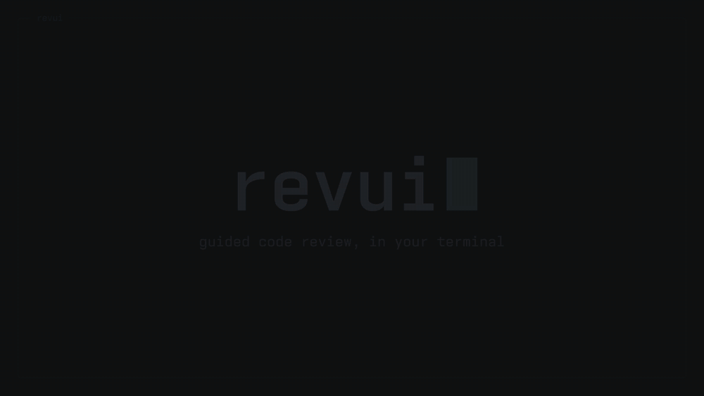
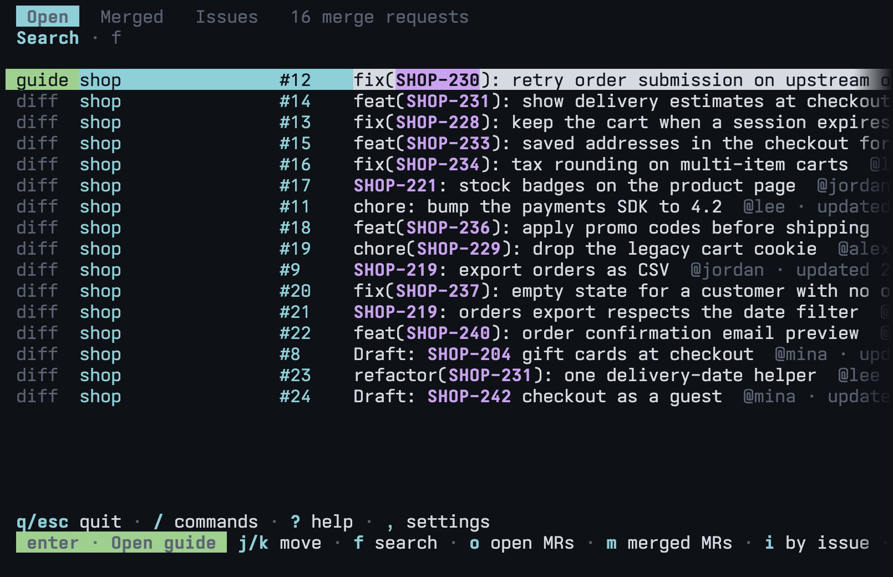
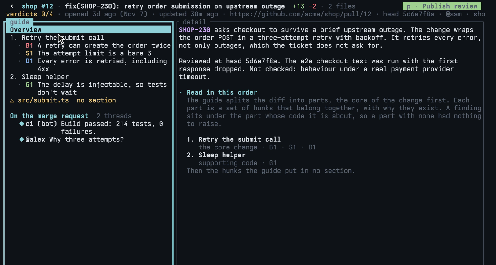
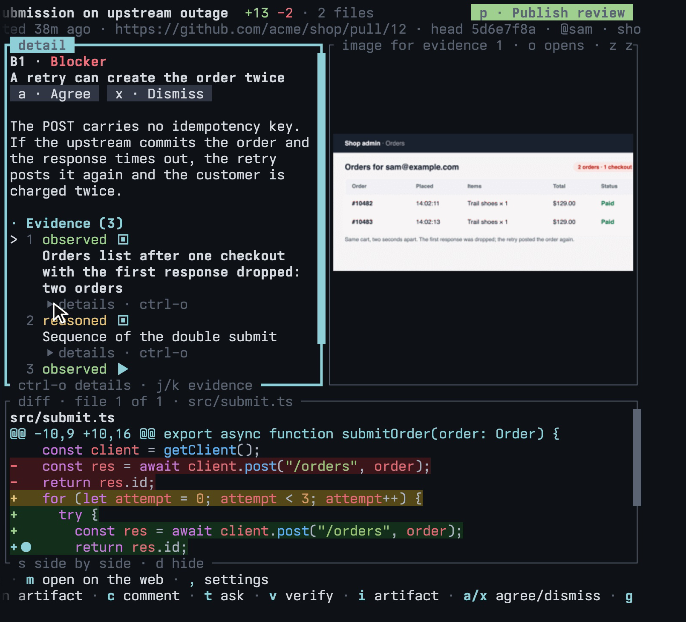
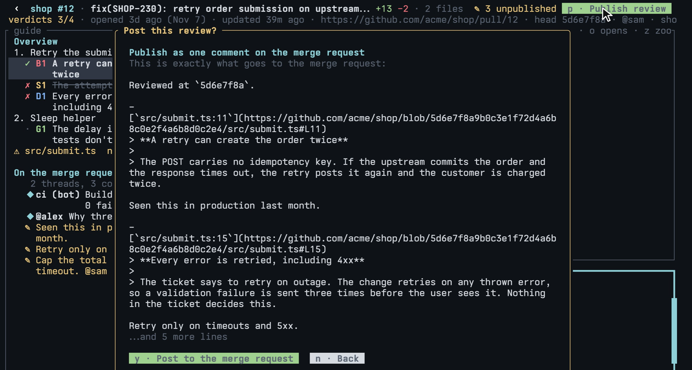
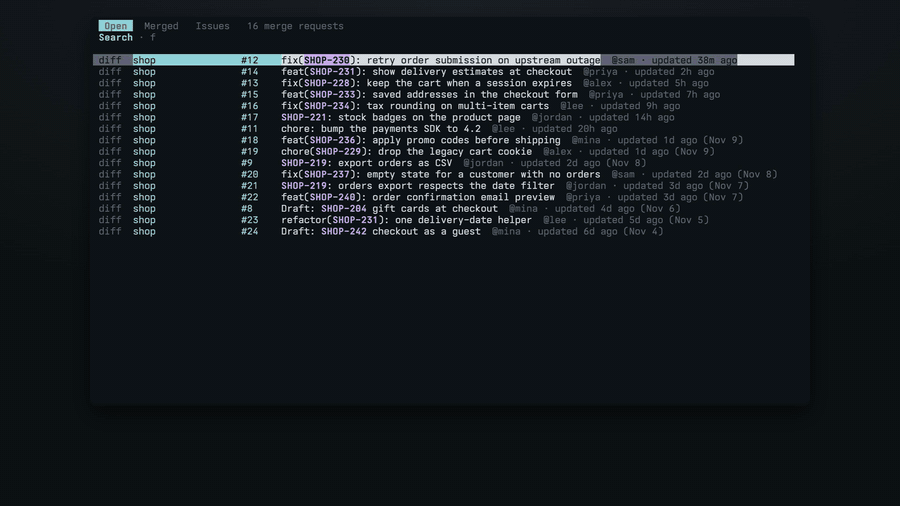
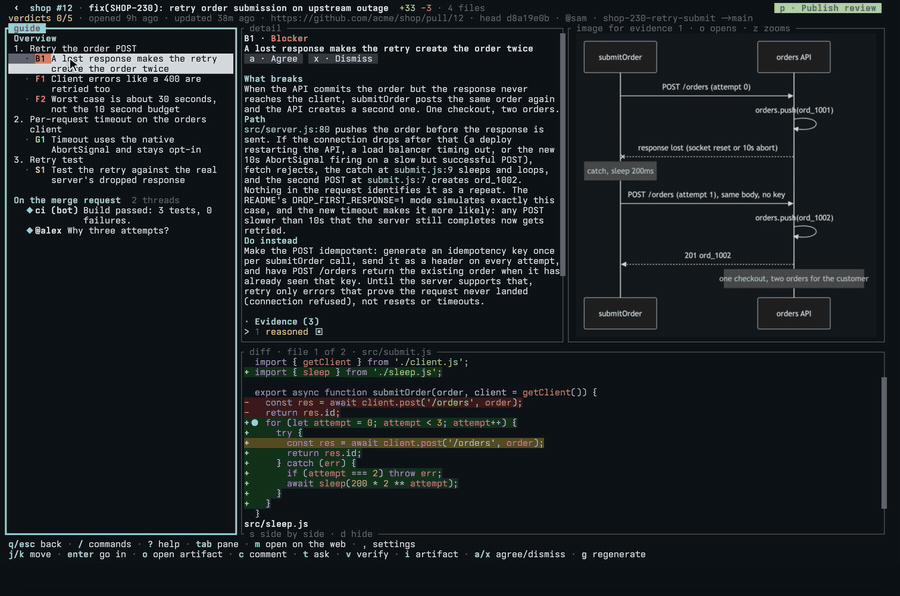
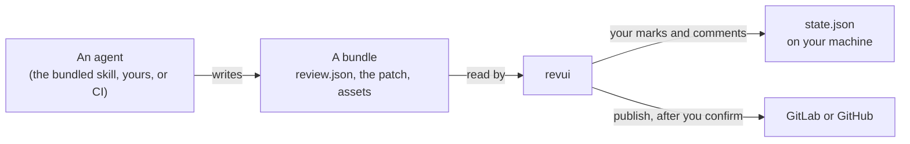

<p align="center">
  <picture>
    <source media="(prefers-color-scheme: dark)" srcset="docs/logo-dark.svg">
    
  </picture>
</p>

<p align="center">
  An agent reviews the change and writes a guide.<br>
  You read it in reading order, check what matters, and publish your own review.
</p>

<p align="center">
  
</p>

## Quick start

```sh
cargo install --git https://github.com/Volpestyle/revui
revui
```

You need Rust and the CLI of your code host, signed in: `glab` for GitLab or
`gh` for GitHub. The first run offers to set itself up, either with a coding
agent or by hand. Then pick a merge request and press `g` to get a guide.

## What you get

<table>
  <tr>
    <td width="50%"></td>
    <td width="50%"></td>
  </tr>
  <tr>
    <td><b>Your merge requests and pull requests.</b> Open, merged, or grouped by issue. <code>g</code> writes a guide for any of them.</td>
    <td><b>A guide, not a wall of diff.</b> The change is split into parts, the core first, with one paragraph on why each exists.</td>
  </tr>
  <tr>
    <td></td>
    <td></td>
  </tr>
  <tr>
    <td><b>Findings with evidence you can judge.</b> Each one says how it was checked: observed in a run, verified by a tool, or reasoned from reading. Screenshots and diagrams sit beside the code.</td>
    <td><b>Your review, in your words.</b> You see the exact text before anything is posted, and nothing goes out until you confirm.</td>
  </tr>
</table>

Two things it will not do:

- **Hide code.** A hunk the guide left out is flagged as "no section", and a
  guide that cites code outside the diff does not load.
- **Post for you.** Only what you agreed with, pushed back on or wrote yourself
  goes out, and only when you publish.

## With an agent

revui starts your coding agent in a tab when a job needs one. These are real
runs against a small demo project, sped up where the badge says so.

**Generate a guide.** `g` on any merge request has the agent review it and write the guide.

<p align="center"></p>

**Ask about what you are looking at.** `t` opens the agent in a tab, already told which finding you are on. Tabs hold your agents, your editor and settings over the review.

<p align="center"></p>

## A review, start to finish

1. **Pick** a merge request from the list. Press `g` if it has no guide yet.
2. **Read** the parts top to bottom. Each finding sits under the code it is about.
3. **Decide.** `a` agrees with a finding and `x` dismisses it. Not convinced?
   `v` has an agent reproduce it locally, `i` asks for a screenshot or diagram,
   and `t` just asks a question.
4. **Comment** with `c`: on a finding, a line, or a block of lines you dragged over.
5. **Publish** with `p`: as one comment, one comment plus approval, or a thread
   per point on the diff.

Agents and your editor open in tabs inside revui, so you never leave the review.
`ctrl-q` switches between them.

## Keys

Everything also works with the mouse: every hint on screen is clickable, panes
resize by dragging, and dragging over text copies it. `/` lists every command
and `?` explains the screen you are on.

| On the list | |
| --- | --- |
| `o` `m` `i` | open, merged, or grouped by issue |
| `f` | search |
| `enter` | open the selected one |
| `g` | write a guide for it |

| In a review | |
| --- | --- |
| `j` `k`, `tab` | move, switch pane |
| `a` `x` | agree or dismiss a finding, accept or push back on a decision |
| `c` `C` | comment on what is under the cursor, or on the whole merge request |
| `t` `v` `i` | ask an agent, have it verify a finding, have it make an artifact |
| `o` `O` | open the file or the artifact, or every file in this part |
| `space` | in the artifact pane, play or pause a recording (needs `ffmpeg`) |
| `d` `s` | hide the diff, put it beside the detail pane or under it |
| `u` `U` | page down and up |
| `p` | publish your review, after a preview |
| `R` `R` | discard your marks and unpublished comments |
| `ctrl-q` | switch between the review and its tabs |
| `q` | back |

## Works with

| | |
| --- | --- |
| **Code hosts** | GitLab through `glab`, GitHub through `gh` |
| **Coding agents** | Claude Code out of the box, or any agent you can start from a command |
| **Editors** | Neovim, VS Code, or anything else that opens a file from a command |
| **Terminals** | Any. Images show inline with Kitty, Sixel or iTerm2 graphics, and as block characters elsewhere |
| **Multiplexers** | tmux, Herdr, or none: agents can open in a tab inside revui, or in a pane of yours |

## Configuration

The smallest config is the repos to list, in `~/.config/revui/config.json`:

```json
{
  "repos": ["group/project", "github.com/owner/repo"]
}
```

A plain `group/project` is a GitLab project and `github.com/owner/repo` is a
GitHub repo. `,` inside revui opens the file, `revui doctor` says what is still
missing, and `revui setup` has an agent write it for you.

Your editor, your agent and where each opens are one command apiece. See
[docs/config.md](docs/config.md) for every key.

## How it fits together



A guide is a plain directory. revui only reads it, so anything can write one:
`revui format` prints the format and `revui check <dir>` validates the result.

    revui                 the list of merge requests and pull requests
    revui <dir>           open a bundle directly
    revui fetch <url>     make or find the bundle for one, listed or not
    revui help            every command

<sub>The wordmark is set in <a href="https://vercel.com/font">Geist Mono</a> (OFL-1.1).</sub>
