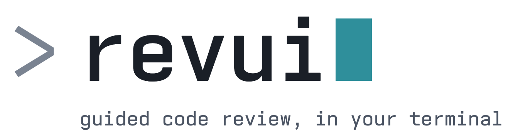

  <picture>
    <source media="(prefers-color-scheme: dark)" srcset="docs/logo-dark.png">
    
  </picture>

  

<a href="docs/demo.mp4">Watch the demo in full quality</a>

`revui` is a terminal viewer for guided code reviews. It lists your open GitLab
merge requests and GitHub pull requests, opens one as a diff, and when an agent
has written a guide for it, walks you through the change in reading order: the
core of the change first, with each finding next to the code it is about.

- **A guide, not a wall of diff.** The change is split into parts with one
  paragraph on why each exists. Findings, questions and good calls sit under the
  part they belong to.
- **Evidence you can judge.** Every claim says how it was checked: observed in a
  run, verified by a tool, or reasoned from reading. Screenshots and diagrams
  show inline, beside the code.
- **The guide never replaces the diff.** A hunk the guide left out is shown as
  "no section", and a guide that cites code outside the diff does not load.
- **Your review, in your words.** Agree with a finding, dismiss it, push back on
  a decision, comment on a line or a block. Nothing is posted until you have seen
  the exact text and confirmed.
- **Agents and your editor, in tabs.** Ask an agent about what you are looking
  at, have it reproduce a finding, or open the file in your editor, without
  leaving the review.
- **Your setup.** GitLab through `glab`, GitHub through `gh`. Any editor, any
  coding agent, any terminal multiplexer: each is one command in the config.

## Install

Needs Rust (`cargo`) and the CLI of your code host, signed in: `glab` for GitLab,
`gh` for GitHub.

    cargo install --git https://github.com/Volpestyle/revui
    revui                      # the first run offers to set itself up

On first run revui offers two ways to set up: let a coding agent do it, or edit
the config yourself. The agent looks at your terminal and editor, asks which
repos you review, writes `~/.config/revui/config.json`, and checks its work with
`revui doctor`. You can start that any time with `revui setup`, or hand
`revui setup --guide` to an agent of your own.

By hand, the smallest config is the repos to list:

    {
      "repos": ["group/project", "github.com/owner/repo"],
      "groups": []
    }

A plain `group/project` is a GitLab project. A GitHub repo is written as
`github.com/owner/repo`, or plainly as `owner/repo` once `"host": "github"` makes
GitHub the default. `groups` lists every project under a GitLab group. Any merge
request or pull request also opens by URL with `revui fetch <url>`, listed or not.

`revui doctor` says what is still missing, and `,` inside revui opens the config.

## Using it

    revui                 the list of merge requests and pull requests
    revui <dir>           open a bundle directly
    revui fetch <url>     make or find the bundle for one, listed or not
    revui help            every command

Everything works with the keyboard and with the mouse. Every hint on screen is
clickable, panes resize by dragging their dividers, and dragging over text
copies it. `/` opens the command list, filtered as you type, and `?` explains
the screen you are on.

| On the list | |
| --- | --- |
| `o` `m` `i` | open, merged, or grouped by issue |
| `f` | search |
| `enter` | open the selected one (a click on the selected row does the same) |
| `g` | write a guide for it |

| In a review | |
| --- | --- |
| `j` `k`, `tab` | move, switch pane |
| `enter` | go into the detail pane |
| `a` `x` | agree or dismiss a finding, accept or push back on a decision |
| `c` `C` | comment on what is under the cursor, or on the whole merge request |
| `t` `v` `i` | ask an agent, have it verify a finding, have it make an artifact |
| `o` `O` | open the file (or the artifact), or every file in this part |
| `d` `s` | hide the diff, put it beside the detail pane or under it |
| `u` `U` | page down and up |
| `p` | publish your review, after a preview |
| `R` `R` | discard your marks and unpublished comments |
| `ctrl-q` | switch between the review and its tabs (agents, editor, settings) |
| `q` | back |

The diff is syntax highlighted by file type, with added and removed lines tinted
and the line a finding points at marked in yellow. Drag over several lines and
press `c` to comment on that block. In a comment, `@` offers the people already
on the merge request and `tab` completes the name.

## Getting a guide

Press `g` in a review or on the list, or ask your agent for `/revui-guide <merge request or pull request URL>`.
An open review reloads when the guide lands. `g` runs the `generate` command from the
config, with the merge request in `$REVUI_URL`. The default runs Claude Code in a
tab inside revui, so you can watch it and answer its prompts; `ctrl-q` goes back
to the review while it works. Your own `generate` runs in the background unless
you add `"generate_modal": true`. To run it elsewhere:

    "generate": "tmux new-window \"claude '/revui-guide $REVUI_URL'\""

Any agent can write a guide: `revui format` prints the format, and
`revui check <dir>` validates the result.

## Which Claude, and Linear projects

`"claude": "my-wrapper"` names the command that starts Claude Code (default
`claude`). It reaches every configured command as `$REVUI_CLAUDE`, and the
default agent and guide commands use it.

The Issues view (`i`) groups merge requests by ticket. With a Linear API key in
`$LINEAR_API_KEY` or `"linear_key"`, tickets are grouped under their Linear
project too. Create a key at Linear > Settings > Security & access.

## Accent colour

`"accent"` sets the highlight colour: a name (`cyan`, `magenta`, `lightgreen`,
`yellow`, ...) or a hex value such as `"#d77757"`. The default is cyan. It applies
when the settings tab closes.

## How agents drive the product

`v` and `i` ask an agent to reproduce something locally, off your screen. Say how
in `"drive"`: one or two sentences naming what to use here (your terminal app's
browser, Playwright, `agent-desktop`, a local-stack skill). Agents read it with
`revui drive`. Unset, they pick a background tool they can find and ask before
anything that would take the screen.

The how is a second bundled skill, `revui-drive` (`revui skill drive` prints it,
`revui skill install` installs it with the other). It is generic: it finds the
local stack from the repo, picks a driving tool from what `revui drive` reports on
the machine, and keeps short notes per repo in `~/.local/share/revui/notes/`, so
the start command and sign-in are worked out once. A project's own skill for
running its product still wins when there is one.

A third bundled skill, `revui-guide`, is what `g` runs by default: it reviews the
merge request or pull request and writes the guide. Point `generate` at your own
review skill when you have one that follows `revui format`.

## Opening a file

`enter` opens the file under the cursor. The default opens it on the web at that line
(`$REVUI_FILE_URL`). Set `open` to use an editor on a local clone. It gets
`$REVUI_FILE`, `$REVUI_LINE`, `$REVUI_REPO` (the project path) and `$REVUI_SHA`:

    "open": "nvim +$REVUI_LINE ~/src/$REVUI_REPO/\"$REVUI_FILE\""
    "open": "code -g ~/src/$REVUI_REPO/\"$REVUI_FILE\":$REVUI_LINE"

A local clone shows the branch it has checked out, which may not be the merge
request's head. `$REVUI_HEAD_FILE` is the file as it is at the head and
`$REVUI_BASE_FILE` the same file before the merge request: revui fetches them
into the bundle, read-only, the first time a command asks. Open both in your
editor's diff mode to see the change in context.

With `"open_modal": true` the command runs in a terminal drawn over the review
instead of taking the screen. `ctrl-q` hides it and `enter` shows it again. To
collect several files in one editor, add `open_more`: it runs when the editor is
already open, with `$REVUI_SOCKET` naming a socket path that is stable for the
session. For Neovim, which then shows each file as a tab:

    "open_modal": true,
    "open": "nvim --listen \"$REVUI_SOCKET\" +$REVUI_LINE \"$REVUI_HEAD_FILE\"",
    "open_more": "nvim --server \"$REVUI_SOCKET\" --remote-tab \"$REVUI_HEAD_FILE\""

## Asking an agent

`t` starts a companion agent that has read the guide and knows what you are
looking at, so you can ask it about the change. `v` asks it to verify the finding
under the cursor (or a section's unproven findings) by running something, and to
record the result in the guide: `confirmed` with observed evidence, or
`unreproduced`. The open review reloads when the agent saves. To verify specific
claims, pick evidence entries first with `space` or a click: the detail pane's
bottom edge shows how many are picked, and `v` sends just those.

Pressing `t` or `v` again goes to the companion that is already running for this
merge request. `T` and `V` let you choose instead: the running companion, or a new
agent in any of the places you configured.

Where an agent opens is the `agents` list in the config. The first entry is the
default. Out of the box there is one, which runs Claude Code in a full-screen tab
over the review. `ctrl-q` goes back to the review while it keeps working, and
`ctrl-q` again, or the tab's number, brings the tabs forward. Keep `ctrl` held and
press `q` again to step through the tabs; let go, and the next `ctrl-q` goes back
to the review. That needs a terminal that reports key releases (`revui probe` says
whether yours does). In one that doesn't, `ctrl-q` only switches between the tabs
and the review: click a tab or press its number to change tabs.

    "agents": [
      { "name": "agent", "modal": true,
        "run": "claude --session-id \"$REVUI_SESSION_ID\"",
        "resume": "claude --resume \"$REVUI_SESSION_ID\"" }
    ]

- `run` starts a new agent. revui then types a one-line prompt into its input
  (which guide, and what you are looking at) and leaves it for you to edit and
  send. A `run` that passes `$REVUI_PROMPT` itself sends it straight away instead.
- `modal: true` runs it in a tab over the review. Follow-ups are typed into that
  tab. If you quit the agent, `resume` brings the same conversation back the next
  time, in the directory it started in, even after restarting revui.
  `$REVUI_SESSION_ID` is a UUID revui makes for each new agent.
- Without `modal`, the command must return at once (a split, a tab, a window).
  `send` then delivers follow-ups to it: whatever `run` printed is in
  `$REVUI_SESSION`, so print the pane or session id there. Leave `send` out and
  every press starts a new agent.
- Nothing takes the terminal away from revui. A program you interact with runs in a
  tab (`modal: true`; the old `foreground: true` now means the same). A command
  without it must return at once, like one that opens a pane elsewhere.

A tmux split that is reused:

    { "name": "split",
      "run": "tmux split-window -h -P -F '#{pane_id}' -e \"REVUI_PROMPT=$REVUI_PROMPT\" 'claude \"$REVUI_PROMPT\"'",
      "send": "tmux send-keys -t \"$REVUI_SESSION\" \"$REVUI_PROMPT\" Enter" }

Agents learn how to read and update a bundle from `revui skill`, which the prompt
tells them to run. `revui skill install` also installs it as a Claude Code skill,
so any session can work on a bundle when you ask.

Selecting text with the mouse copies it to the clipboard when you release.

## Notes, threads and finishing a review

- `c` adds a comment on what is under the cursor: a finding, a line in the diff (focus
  the diff with `tab`, move with `j`/`k`), or a reply when a thread is selected.
  `C` adds one on the merge request as a whole. Comments show as `●` on their diff
  line and as rows at the end of the guide list. `c` on a comment edits it, `x` deletes it.
- Threads already on the merge request are fetched when a review opens. They show
  the same way, in cyan, with the whole conversation in the detail pane.
- `a` and `x` on a finding record whether you agree. There is no "start": the
  review is whatever marks and comments you have made.
- `p` publishes it. What goes out is the findings you agreed with, the decisions
  you pushed back on, and your comments. You choose one comment, one comment plus
  approval, or a thread per point on the diff, then see the exact text and
  confirm. Nothing is sent before that. You can also copy the text and post
  nothing.

Notes and verdicts live in `state.json` in the bundle, on your machine.

## Images

Evidence screenshots render inline in terminals with Kitty, Sixel or iTerm2
graphics, and as block characters elsewhere. `REVUI_IMAGES=halfblocks` forces
block characters.

## How it fits together

A guide is a plain directory, called a bundle: `review.json` (the parts and
findings), the raw patch, and an `assets/` folder for screenshots and diagrams.
revui only reads it. Anything can write one: the bundled `revui-guide` skill,
your own review skill, or a CI job. `revui format` prints the format and
`revui check <dir>` validates a bundle. Your marks and comments stay in
`state.json` beside it, on your machine.

The wordmark is set in [Ioskeley Mono](https://github.com/ahatem/IoskeleyMono) (OFL-1.1).
